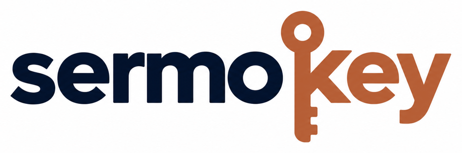
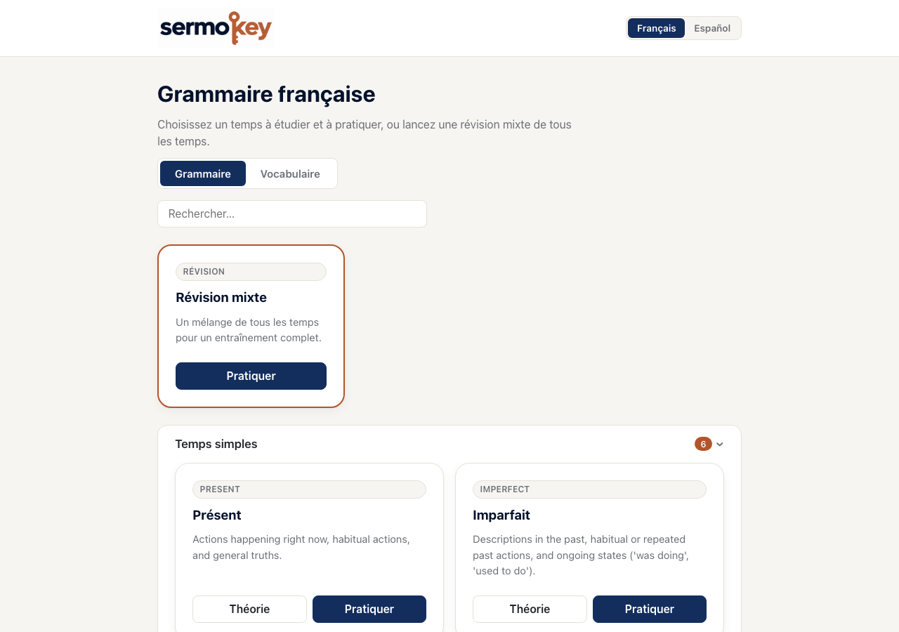

<p align="center">
  
</p>

<p align="center"><strong>Unlock new languages.</strong></p>

Sermokey is a language learning platform focused on grammar: interactive
theory pages, conjugation drills, vocabulary practice, and spaced-repetition
flashcards, with immersive UI text in the language you're studying.

Currently supported: **French** and **Spanish**. **German support is planned.**

<p align="center">
  
</p>

## Features

- **Theory** — reference pages per tense/category, grouped and searchable.
- **Exercises** — generated conjugation and translation drills per tense,
  with multiple exercise types.
- **Vocabulary** — categorized word lists with a reversible quiz direction.
- **Flashcards / SRS** — spaced-repetition review persisted locally in the
  browser.
- **Immersive i18n** — switching the study language also switches the
  interface copy (e.g. "Vérifier" vs "Comprobar"), not just the exercises.

## Tech stack

- **Backend**: Go (`backend/`) — a small JSON API (`net/http`), no external
  framework.
- **Frontend**: Vue 3 + TypeScript + Vite (`frontend/`).

## Getting started

```sh
make install   # npm install for the frontend
make run       # starts backend (:8080) and frontend (:5173) in the background
make logs      # tail both logs
make stop      # stop whatever `make run` started
```

Run `make help` for the full list of targets (`build`, `test`, `clean`, ...).

## Project layout

```
backend/   Go JSON API (cmd/server, internal/grammar, internal/httpapi)
frontend/  Vue 3 + TypeScript + Vite single-page app
assets/    Project branding (logo, screenshots)
```

## Roadmap

- [ ] German language support

## License

[MIT](LICENSE)
