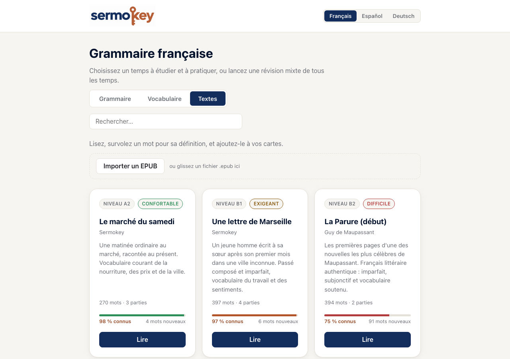
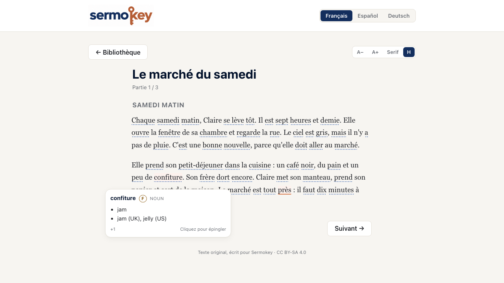

<p align="center">
  
</p>

<p align="center"><strong>Unlock new languages.</strong></p>

Sermokey is a language learning platform focused on grammar: interactive
theory pages, conjugation drills, vocabulary practice, and spaced-repetition
flashcards, with immersive UI text in the language you're studying.

Currently supported: **French**, **Spanish**, and **German**.

<p align="center">
  
</p>

## Features

- **Theory** — reference pages per tense/category, grouped and searchable.
- **Exercises** — generated conjugation and translation drills per tense,
  with multiple exercise types.
- **Vocabulary** — ~2,000–2,250 curated words per language across 27
  categories, with a reversible quiz direction.
- **Reading** — graded and authentic texts in all three languages, with a
  pop-up dictionary. Hover a word for its meaning, click to pin a panel,
  select a phrase to capture it, and send words straight to the flashcard
  deck with the sentence you met them in.
- **EPUB import** — drop in a book and read it with the same tools.
- **Flashcards / SRS** — spaced-repetition review persisted locally in the
  browser.
- **Immersive i18n** — switching the study language also switches the
  interface copy (e.g. "Vérifier" vs "Comprobar" vs "Prüfen"), not just the
  exercises.

## Vocabulary selection

Word lists are built from the intersection of frequency and pedagogy rather
than either alone — pure frequency produces an unteachable list, pure
thematic grouping produces categories padded with rare words:

1. **Frequency floor** — lemmas sit inside roughly the top 5,000 of a
   reference frequency source, with the bulk inside the top 3,000.
2. **Thematic budget** — category sizes are proportional to communicative
   load, not split evenly. `verbes` carries ~270 words; `couleurs` ~20.
3. **Closed-class guarantee** — every pronoun, interrogative, determiner,
   preposition and conjunction, plus the top ~150 verbs, must be present.
   These are finite sets, so completeness is a checkable property, and
   `grammar.ValidateVocab` checks it on every test run.

Reference sources: French — Lonsdale & Le Bras, *A Frequency Dictionary of
French*, plus CEFRLex/FLELex. Spanish — the Instituto Cervantes *Plan
Curricular* CEFR inventory, plus Davies' frequency dictionary. German — the
Goethe-Institut A1/A2/B1 Wortlisten, plus Tschirner & Möhring.

Target size is ~2,000–2,250 lemmas per language. B2 receptive vocabulary is
roughly 3,250–3,750 word families (Milton 2010); a curated deck of this size
is the practical core of that, with the remainder acquired incidentally and
through cognates.

## Reading

<p align="center">
  
</p>

The reading tab is built around four replaceable parts, because the goal is
to read an imported EPUB with the same interface that reads the bundled
texts:

| Seam | Responsibility | Implementations |
|---|---|---|
| `Catalog` | where documents come from | bundled texts, imported EPUBs |
| `Tokenizer` | running text → word spans | fr, es, de |
| `Analyzer` | surface form → lemma + senses | curated → Wiktionary → rules |
| SRS | scheduling | shared, language-agnostic |

Only the tokenizer and analyzer are language-aware, and only the catalog is
source-aware. That split paid off exactly as intended: EPUB support is a
`Catalog` plus a parser and touched no reader code, and the three languages
differ by a tokenizer, a closed-class list and a config struct — the
ranking, lexicon loading, phrase merging and corpus handling are shared.

Adding a fourth language means writing `internal/reading/xx/`: a tokenizer
for its orthography, its closed-class set, a generated lexicon, three texts,
and a dozen lines of wiring. Reading availability is deliberately modelled
as a subset of the supported languages, so a new language's grammar can
ship before its corpus does.

A few decisions worth knowing about:

- **Words saved while reading share the vocabulary deck.** The SRS card id
  is minted server-side, so saving `maison` from a text touches the same
  card the Vocabulary tab schedules rather than creating a duplicate with
  its own review history.
- **Difficulty is per reader, not per text.** Each text reports a
  token-weighted frequency table; the browser intersects it with your deck
  to show what share you already know. Hu & Nation (2000) put adequate
  unassisted comprehension at ~98% of running words and assisted at ~95%,
  which is where the comfortable / challenging / hard bands come from.
- **Coverage counts recognition, not mastery.** A word counts once you
  have reviewed it successfully even once — that is what the comprehension
  thresholds mean. Requiring the month-long intervals that make a card
  "mastered" scored a learner who had worked through a thousand words
  barely above one who had studied nothing, and labelled every text,
  including the beginner ones, too hard. The page itself still
  distinguishes the two: a word being learned is marked differently from
  one that is mature.
- **Names are found by mid-sentence capitalisation.** Every sentence-initial
  word is capitalised, so that position says nothing; a capital in the
  middle of a sentence is unambiguous. The decision is made once per
  document and applied throughout, which is what stops a character called
  Clara being read as the adjective *claro*, and what keeps the cast of an
  imported novel out of your vocabulary deck.
- **Function words and proper nouns are counted as known.** Articles and
  clitics are grammar rather than vocabulary, and coverage studies treat
  names as known words; together they are ~40% of running French, so
  treating them as unlearned vocabulary made every text score around 70%.
- **The sentence travels with the word.** A gloss recalled in context is
  retained better than a bare pair, so each saved word keeps the sentence
  it was met in and shows it on the flashcard's answer side.
- **Multi-word items are single tokens.** "pomme de terre" and "se lève"
  are merged before analysis and glossed as units, because formulaic
  sequences are learned whole — and because "terre" in the middle of a
  potato is the most misleading gloss available.

### Importing EPUBs

Drag a `.epub` onto the Texts tab. The book is parsed, tokenized and
analyzed by the same engine that serves the bundled corpus, so hovering,
phrase selection, status colouring and saving to the deck all work
identically.

Imported books are stored as the original file under
`$SERMOKEY_LIBRARY_DIR` (unset disables persistence) and re-parsed at
startup, which means a later improvement to a tokenizer or lexicon takes
effect on books already imported. Their IDs are derived from the file's
bytes, so re-importing updates one entry rather than accumulating copies,
and reading positions survive.

Only text is extracted — images, layout and fonts are dropped. This is a
reading surface where every word has to be a hoverable token, not a
faithful rendering of the publisher's design.

### The lexicons

Definitions and inflections come from English Wiktionary via
[wiktextract](https://github.com/tatuylonen/wiktextract). This is what lets
`parlons` resolve to `parler`, `hablamos` to `hablar` and `Kinder` to
`das Kind`:

| | headwords | inflected forms |
|---|---|---|
| French | 99k | 362k |
| Spanish | 119k | 1.15M |
| German | 97k | 1.34M |

The tables are generated, gzipped (28 MB total) and committed, so building
and testing never needs the ~1 GB source extracts:

```sh
curl -LO https://kaikki.org/dictionary/French/kaikki.org-dictionary-French.jsonl
cd backend && go run ./cmd/lexgen \
    -in kaikki.org-dictionary-French.jsonl \
    -out internal/reading/fr/data
```

They are searched by binary search over the sorted table rather than loaded
into maps. With 2.8 million rows across three languages the map headers
alone cost about a gigabyte; the sorted blob plus a 4-byte offset per row
brings the whole server to roughly 380 MB resident.

Wiktionary is dual-licensed CC BY-SA and GFDL; the attribution that requires
is rendered in the reader's word panel.

### Adding a text

Drop a file in `backend/internal/reading/{fr,es,de}/texts/`. It is picked up by a
glob, so there is no code to change — the same philosophy as the vocabulary
CSV. The header block supplies the metadata:

```
id: mon-texte
title: Mon texte
level: B1
license: CC BY-SA 4.0
blurb: Une phrase de description.

# Première partie

Le premier paragraphe.
```

`go test ./internal/reading/...` then checks it: that the tokenizer
round-trips every paragraph byte for byte, that the analyzer resolves at
least 95% of its word tokens, and that no curated word resolves to an SRS
id outside the vocabulary deck.

## Tech stack

- **Backend**: Go (`backend/`) — a small JSON API (`net/http`), no external
  framework.
- **Frontend**: Vue 3 + TypeScript + Vite (`frontend/`).

## Getting started

```sh
make install   # npm install for the frontend
make run       # starts backend (:8080) and frontend (:5173) in the background
make logs      # tail both logs
make stop      # stop whatever `make run` started
```

Run `make help` for the full list of targets (`build`, `test`, `clean`, ...).

## Project layout

```
backend/   Go JSON API
  cmd/server          the API itself
  cmd/lexgen          dev tool: builds the reading lexicon from Wiktionary
  internal/grammar    conjugation engines and vocabulary, per language
  internal/reading    reader core: document model, lexicon, analyzer, phrases
    fr/ es/ de/         per-language tokenizer, closed-class set, texts
    epub/               EPUB parser and on-disk library
  internal/httpapi    routes, handlers, DTOs
frontend/  Vue 3 + TypeScript + Vite single-page app
  src/reading         word status, saved words, prefs, selection helpers
  src/srs             spaced repetition (SM-2), localStorage-backed
assets/    Project branding (logo, screenshots)
```

## Roadmap

See open issues for upcoming work.

## License

[MIT](LICENSE)
